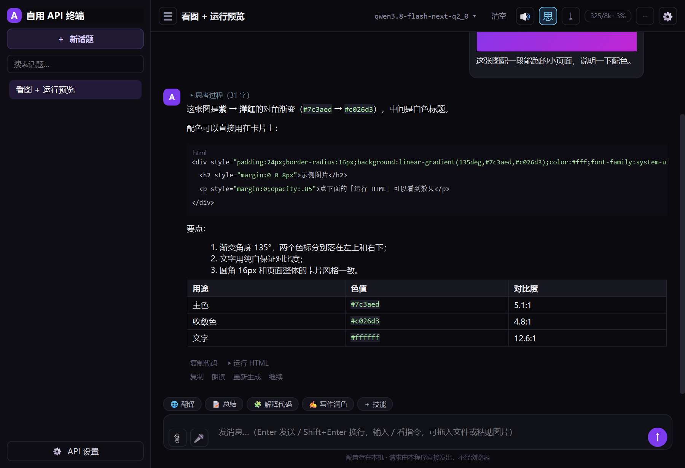

# 自用 API 终端（原生窗口版）

一个 Windows 桌面端的 OpenAI 兼容聊天客户端。Python + PySide6（Qt），不套浏览器外壳，
请求由进程直接发出，配置和聊天记录都存在本机。

原来那版是单文件网页（Hermes Agent），这一版是重写的原生程序；网页版的功能基本都搬过来了，
另外补上了消息编辑、上下文管理、自定义工具、插件、模型对比、画图这些。



---

## 一、怎么运行

双击 **`自用API终端.exe`**。整个文件夹要一起搬走（`_internal` 是同目录的运行时）。

```
自用API终端\
├─ 自用API终端.exe     ← 双击这个
└─ _internal\          ← 运行时，别删、别单独搬走 exe
```

> **为什么不是单文件 exe**：单文件版每次启动要把运行时解压到 `%TEMP%`，这台机器的
> `%TEMP%`（`D:\temp`）在双击时被系统策略挡住，会弹 `Could not create temporary directory!`。
> 目录版不需要解压，最稳。真要单文件：`build.ps1 -OneFile`（前提是 `%TEMP%` 可写）。

第一次启动会自动弹「API 设置」：

1. 选个预设（DeepSeek / OpenAI / Moonshot / 智谱 / 通义 / Groq / OpenRouter / Ollama），或手填 Base URL
2. 填 API Key（本地服务一般随便填）、模型名
3. 点「拉取模型」从接口取模型列表；点「测试连接」当场验证（最多等 25 秒）

---

## 二、功能一览

### 聊天

| 功能 | 说明 |
|---|---|
| 流式回答 | 边生成边显示；`■` 或 `Ctrl+Shift+S` 随时停止，已收到的内容会保留 |
| 思考过程 | 推理模型的分段内容折叠显示；顶栏 `思` 按钮控制显示/隐藏 |
| 工具调用 | 内置计算器、当前时间、抓网页；调用了什么会在回答下面列出 |
| Markdown | 标题、粗体/斜体/删除线、行内代码、代码高亮、引用、**表格**、链接、列表 |
| 重新生成 | 丢掉这条回答重问；它后面还有对话时会先确认（会一起删掉） |
| 继续 | 接着往下写，写完**并回同一条回答** |
| 复制 / 复制代码 / 朗读 | 每条回答下面一排小按钮 |
| 用时统计 | `3.2 秒 · 128 字 · 40.0 字/秒` |

### 附件

- **图片**：📎 选择、直接拖进窗口、或 `Ctrl+V` 粘贴；消息里显示缩略图，点开看大图
- **文本文件**：代码、md、json、csv、日志…内容直接内联进请求
- **PDF / Word**：自动抽文本（扫描件 PDF 抽不出，会提示）
- 输入框上方有附件条，可以单独删掉某一个

### 运行网页

回答里出现 HTML / SVG 代码块时，下面会有「▶ 运行 HTML」，点开是**内嵌浏览器预览**
（QtWebEngine），也能一键用系统浏览器打开。

### 话题与配置

- 左侧：新建、**搜索（标题和正文都搜）**、右键重命名 / 置顶 / **导出为 Markdown / JSON** / 删除，双击改名
- 顶栏「配置 ▾」切换多套 API；`⚙` 打开设置
- 每个话题可以有自己的**系统提示词**（`⋯ → 本话题系统提示词`），优先于全局

### 上下文管理（重要）

顶栏那个 `27.9k/16k · 170%` 是**当前话题用了多少 token / 上限**，按字数粗估：

- 80% 以下正常显示，≥85% 变黄，≥100% 变红
- **点一下这个数字**可以：删掉最早的消息 / 新建话题 / 清空话题 / 改上限
- **发送前如果超了**，会先问你要不要「自动删掉最早的消息」（删到上限的 70%）
- 上限默认自动读 llama.cpp 的 `/props`（`n_ctx`）；读不到就是 8192，也可以在
  `⋯ → 对话参数` 里手填

> 超限的请求本地模型会跑得极慢，甚至直接失败——看起来就像「卡死了」。换话题聊，
> 或点一下那个数字清理历史。

### 朗读与语音输入

- **朗读**：每条回答下的「朗读」用 Windows 自带语音读出来；顶栏 🔊 是自动朗读开关，
  `Ctrl+Shift+S` 同时关闭朗读
- **语音输入**：输入框左边 🎤。走 Windows 听写引擎，需要麦克风 + 对应语言的「语音识别」组件
  （中文识别包默认不装，没装会提示）

### 更多（右上角 `⋯`）

| 入口 | 作用 |
|---|---|
| 技能库 | 一段系统提示词起个名字，点标签就套在下一句话上；可增删改 |
| 本话题系统提示词 | 只对这个话题生效 |
| 对话参数 | 温度 / top_p / 最大 tokens（三个预设：精确 0.2·0.9、平衡 0.7·0.95、发散 1.1·0.98）、上下文上限、全局系统提示词 |
| 自定义工具 | 把任意 HTTP 接口包成模型能调用的工具 |
| 打开插件文件夹 | 丢 `.py` 进去加工具（见下） |
| 模型对比 | 一句话问两个模型，左右并排流式回答 |
| 画图 | 调 `/images/generations`，生成后插入对话 |
| 导出 / 导入备份 | 全量 JSON |
| 网页预览用系统浏览器 | 不碰 WebEngine 的保险开关 |
| 打开数据目录 | 直接看 `crash.log`、`media`、`plugins` |

---

## 三、快捷键

| 快捷键 | 作用 |
|--------|------|
| `Enter` / `Shift+Enter` | 发送 / 换行 |
| `Ctrl+K` | 新建话题 |
| `Ctrl+B` | 收起/展开侧边栏 |
| `Ctrl+O` | 选择附件 |
| `Ctrl+,` | 打开 API 设置 |
| `Ctrl+Shift+S` | 停止生成 / 停止朗读 |
| `Esc` | 关闭菜单/对话框 |

### 输入框里的 `/` 指令

| 指令 | 作用 |
|---|---|
| `/new` | 新建话题 |
| `/clear` | 清空当前话题 |
| `/stop` | 停止生成 |
| `/regen` | 重新生成最后一条回答 |
| `/cont` | 接着写最后一条回答 |
| `/sys` | 设置本话题的系统提示词 |
| `/skills` | 技能库 |
| `/params` | 对话参数 |
| `/image` | 画图 |
| `/compare` | 模型对比 |
| `/export` | 导出本话题为 Markdown |
| `/help` | 看全部指令 |

---

## 四、数据存在哪

```
%LOCALAPPDATA%\SelfApiTerminal\
├─ store.json      配置（含密钥）、话题、参数、工具、技能、窗口位置
├─ media\          附件里的图片（store.json 只记路径）
├─ plugins\        插件（.py）
├─ crash.log       崩溃/异常记录（出问题先看这个）
└─ selftest.log    自检输出
```

- 纯明文 JSON，想备份直接拷这个目录，或用 `⋯ → 导出备份`
- 删掉整个目录 = 恢复出厂
- 删 `store.json` 之前先关程序，否则会被覆盖

---

## 五、扩展：自定义工具与插件

### 自定义工具

`⋯ → 自定义工具`：填名称、说明、方法、URL、请求头、请求体。
URL 和请求体里用 `{input}` 表示模型传进来的内容，保存后模型需要时会自己调用。

### 插件

`⋯ → 打开插件文件夹`，把 `.py` 丢进 `%LOCALAPPDATA%\SelfApiTerminal\plugins\`，重启程序生效：

```python
def register(reg):
    reg.add_tool(
        name="hostname",
        description="返回本机计算机名",
        func=lambda args: __import__("socket").gethostname(),
    )
```

> 插件就是直接在你机器上跑的 Python，只放自己写的或信得过的。

---

## 六、出问题怎么办

### 闪退 / 窗口忽然消失

先看 `%LOCALAPPDATA%\SelfApiTerminal\crash.log`（或 `⋯ → 打开数据目录`）。
Windows 事件查看器里如果是：

```
Faulting module name: shiboken6.abi3.dll
Exception code: 0xc0000005
```

那是「Python 还在操作已经被 Qt 销毁的控件」，不是数据坏了。已经做过的加固：

- 换话题、清空、关窗口前先收尾正在跑的流，回调里检查控件是否还活着
- 右键菜单不挂在消息气泡上，菜单动作延后执行（避免菜单收尾时把自身销毁）
- 线程只在主线程回收；退出前先显式销毁窗口再排空事件
- QtWebEngine 按需加载：不点「▶ 运行」就不会初始化内核
- 预览窗口只有一个，反复运行只换内容；退出前先停页面

如果还会闪退：

1. `⋯ → 网页预览用系统浏览器`（之后「运行」走系统浏览器，完全不碰 WebEngine）
2. 还不行就设环境变量 `SELFAPI_NO_WEBENGINE=1` 彻底禁用内嵌浏览器
3. 把 `crash.log` 尾部发我，里面有具体到哪个函数的栈

### 「卡住不动」

- **回答说一半停住**：先看是不是上下文满了（顶栏变红），点那个数字清理历史
- **整个界面没反应**：程序是单线程 UI + 后台线程拉流，正常情况下不会卡；卡住多半是
  模型在啃超长上下文，按上面的办法清历史

### 打不开 / 被 360、Smart App Control 拦

exe 未签名。被拦可以：

```powershell
# 直接用源码跑，功能完全一样
.\.venv\Scripts\python.exe app.py
```

或者双击项目里的 `run-py.bat`。

---

## 七、已知限制

- **单实例**：同时开两个会互相覆盖 `store.json`（后关的赢）
- **未签名**：可能被安全软件拦
- **单文件版不能用**：见开头说明
- **消息分支**（重生成保留旧版本、可切换）没做：它要在同一条回答上再开一路流，
  现有 QThread 方案多路时不稳定，等把流式传输换成队列 + 主线程轮询再补
- **工具调用最多 5 轮**，超过就停（防止模型来回循环）
- **推理内容**按 `reasoning_content` / `reasoning` / `thinking` 三个字段名识别，
  各家字段不一样，没识别到就当普通回答处理
- **朗读 / 语音输入**依赖 Windows 的语音组件；没装语言包就只能英文或直接报错
- **图片生成**依赖服务端支持 `/images/generations`（OpenAI 兼容接口）
- 上下文占用是**按字数估的**（字数 ÷ 1.6），不是真实 token 数，只用来判断该不该清理

---

## 八、和旧网页版对比

| | 网页版（旧） | 原生版（这个） |
|---|---|---|
| 运行方式 | Edge 应用窗口 | 独立 Qt 窗口 |
| 网络请求 | 浏览器 fetch + 本地反向代理 | 进程内直接发 HTTP，无 CORS 概念 |
| 数据 | 浏览器 localStorage | 本地 JSON 文件 + media 目录 |
| 附件 | 图片/文本内嵌 | 图片落盘、文本内联、PDF/Word 抽取 |
| 运行网页 | iframe 预览 | QtWebEngine 内嵌预览（也可开系统浏览器） |
| 朗读 | Web Speech API | Windows SAPI 语音 |
| 声音输入 | 浏览器语音识别 | Windows 听写引擎 |
| 体积 | 8 MB | 约 592 MB（含 QtWebEngine），zip 约 226 MB |
| 安装 | 需要 Edge | 不需要任何额外组件 |

网页版里**没搬过来**的只有 PWA「安装到桌面」入口——原生程序不需要它。

---

## 九、目录结构（开发）

```
hermes-native/
├─ app.py            主窗口、消息气泡、会话、设置对话框、启动入口
├─ api.py            OpenAI 兼容接口：流式、工具回合、模型列表、连通性、画图、/props
├─ store.py          配置/话题/参数的 JSON 存储
├─ workers.py        后台线程：聊天流、一次性任务（含线程回收）
├─ dialogs.py        技能库、对话参数、自定义工具、模型对比、画图
├─ widgets.py        附件条、图片缩略图/大图、网页预览窗口
├─ media.py          附件落盘、data URL、PDF/Word 抽取
├─ md_render.py      Markdown → Qt 富文本（含代码高亮、表格）
├─ theme.py          深色样式表
├─ tts.py            朗读（QtTextToSpeech → SAPI）
├─ voice.py          语音输入（PowerShell + System.Speech）
├─ plugins.py        插件加载
├─ icon.ico          程序图标（gen_icon.py 生成）
├─ build.ps1         打包（默认目录版，-OneFile 出单文件）
├─ rename_dist.py    打包后改成中文名
├─ run-py.bat        不解包、直接用源码跑
├─ dist/
│  ├─ 自用API终端\            绿色版目录（双击里面的 exe）
│  └─ 自用API终端-绿色版.zip   同一份压缩包
├─ docs/screenshot.png
└─ 测试脚本（见下）
```

## 十、自检 / 重打包

```powershell
# 起一个本地假模型（流式、工具回合、图片都支持）
.\.venv\Scripts\python.exe fake_model.py 18899

# 发一条消息 + 截图（不需要联网）
.\.venv\Scripts\python.exe smoke.py shot.png

# 界面构造检查（38 项）
.\.venv\Scripts\python.exe ui_check.py

# 渲染回归（含拿真实 store.json 全量跑一遍）
.\.venv\Scripts\python.exe test_render.py "$env:LOCALAPPDATA\SelfApiTerminal\store.json"

# 其余专项
.\.venv\Scripts\python.exe test_features.py      # 表格/自定义工具/插件/PDF/参数
.\.venv\Scripts\python.exe test_crash.py         # 流式中切话题/关窗口
.\.venv\Scripts\python.exe test_stress_chat.py   # 连发 5 轮 + 重新生成 + 继续
.\.venv\Scripts\python.exe test_settings.py      # 测试连接遇到不回话的服务器
.\.venv\Scripts\python.exe test_click.py         # 点按钮 / 右键菜单
.\.venv\Scripts\python.exe test_attach.py        # 附件链路

# 打包后自检
.\dist\自用API终端\自用API终端.exe --selftest
.\dist\自用API终端\自用API终端.exe --selftest-preview

# 重新打包
powershell -ExecutionPolicy Bypass -File .\build.ps1            # 目录版
powershell -ExecutionPolicy Bypass -File .\build.ps1 -OneFile   # 单文件（%TEMP% 要可写）
```

`--selftest` 默认连 `http://127.0.0.1:18899/v1`，可用 `SELFAPI_BASE` / `SELFAPI_MODEL`
指向别的服务；`SELFAPI_DATA` 可以把数据目录换到别处（测试用）。
